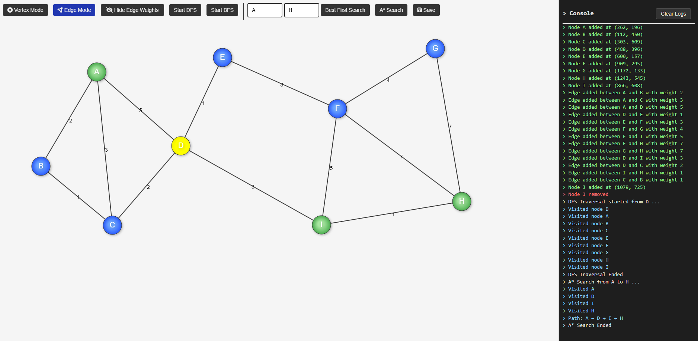

## Tech Stack

- **HTML5 Canvas** — Interactive 2D graph rendering
- **JavaScript (ES6+)** — Graph logic, algorithms, event handling
- **CSS3** — UI styling
- **Font Awesome** — Icons

## Features

### Graph Construction

- **Click** (Vertex Mode) to add nodes
- **Drag and drop** (Any Mode) to reposition nodes
- **Right-click** (Any Mode) to delete nodes
- **Edge Mode**: click two nodes to create undirected, weighted edges
- **Edge weights**: manually enter and toggle visibility

### Graph Traversals

- **Depth First Search (DFS)** with animation
- **Breadth First Search (BFS)** with animation
- **Greedy Best First Search**
- **A\* Pathfinding Algorithm**

### Visualization

- Selected & hovered nodes are highlighted
- Animated traversal shows visited nodes
- Logs console shows visited path and operations
- Shows a tooltip when drawing a new node that overlaps any node on canvas
- Hide edge weights if you don't want to see edge weights on your graph

### Developer Tools

- **Console Panel**: Logs every action (color-coded)
- **Download Image** button to save the canvas as PNG

---

